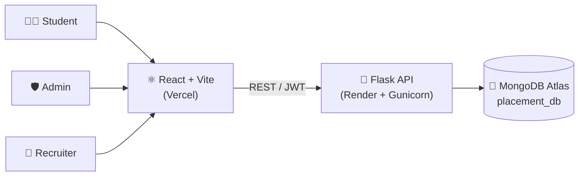

<div align="center">

# 🎓 Cloud-Based Placement Management & Recruitment System

**A full-stack campus placement platform connecting Students, Placement Officers, and Corporate Recruiters.**

<a href="https://frontend-opal-tau-kjcer8fkaw.vercel.app/">  </a>


[Features](#-key-features) •
[Tech Stack](#️-technology-stack) •
[Demo Login](#-demo-credentials) •
[Setup](#-local-development-setup) •
[Deployment](#-deployment) •
[Security](#-security)

</div>

---

## 📖 Overview

Campus placements involve a lot of back-and-forth between students, the placement cell, and recruiters. This system puts the whole recruitment lifecycle in one place: **profile building → eligibility checking → application → interview scheduling → selection**, with real-time analytics for placement officers.

| 👨‍🎓 Students | 🛡️ Placement Officers | 🏢 Recruiters |
| :--- | :--- | :--- |
| Build profiles, find eligible drives, apply in one click, and track progress | Approve companies, create drives, manage pipelines, and view analytics | Post openings, review eligible applicants, and schedule interviews |

---

## 🌟 Key Features

<details open>
<summary><b>👨‍🎓 Student</b></summary>

- 🔐 **Authentication**: Register, log in, and stay signed in with secure JWT sessions
- 📝 **Detailed Profile**: Personal info, academics (10th / 12th / Diploma %, CGPA, active & total backlogs), skills, projects, certifications, and resume URL
- 📊 **Live Profile Completeness**: Real-time 0–100% gauge
- 🔎 **Drive Catalog**: Search and filter by role, company, location, CTC, and branch
- ✅ **Automatic Eligibility Checker**: Compares CGPA, backlogs, branch, and 10th/12th scores against drive requirements, with a detailed breakdown of any failures
- 🖱️ **One-Click Apply** to eligible drives
- 🚦 **Visual Progress Stepper**: `Applied` ➔ `Shortlisted` ➔ `Assessment` ➔ `Technical Interview` ➔ `HR Interview` ➔ `Selected`
- 📅 **Interview Schedule**: Date, time, and Google Meet link for every round
- 🔔 **In-App Notifications**: Drawer with unread-count badge

</details>

<details open>
<summary><b>🛡️ Placement Officer / Admin</b></summary>

- 📈 **Analytics Dashboard**: Total students, registered accounts, approved companies, active drives, total placed, placement %, and CTC averages
- 📊 **Interactive Recharts Visualizations**
  1. Branch-wise placement distribution *(Bar)*
  2. Top company selections *(Horizontal Bar)*
  3. Monthly application trends *(Area)*
  4. Recruitment pipeline breakdown *(Pie)*
  5. Salary package distribution *(Range)*
- 🏢 **Company Approvals**: Approve or reject recruiter registrations before they can post drives
- 🧱 **Drive Creator**: Modal builder with mandatory eligibility thresholds
- 🎓 **Student Directory**: Searchable table with CGPA and backlog metrics
- 🔄 **Global Pipeline Manager**: Update candidate stages across all drives

</details>

<details open>
<summary><b>🏢 Recruiter / Corporate</b></summary>

- 🏷️ **Company Registration**: Create a company profile (pending admin approval)
- 📢 **Opportunity Posting**: Role description, CTC, and eligibility criteria
- 🧑‍💼 **Applicant Evaluation**: Filter eligible applicants, open resumes, and move candidates through stages
- 🗓️ **Interview Scheduler**: Set date, time, meeting link, and instructions, with automatic student notifications

</details>

---

## 🏗️ Architecture



---

## 🛠️ Technology Stack

| Layer | Technologies |
| :--- | :--- |
| **Frontend** | React 18, Vite, Tailwind CSS, React Router DOM, Axios, Lucide React, Recharts |
| **Backend** | Python 3.12, Flask, Flask-CORS, PyMongo, PyJWT, bcrypt, Gunicorn |
| **Database** | MongoDB Atlas (`placement_db`) |
| **Hosting** | Vercel (frontend), Render (backend) |

---

## 📁 Project Structure

```text
Cloud Project/
├── README.md
├── .gitignore
├── backend/
│   ├── app.py                 # Flask app & blueprint registration
│   ├── seed.py                # Seeds demo data into MongoDB
│   ├── config.py              # Environment configuration loader
│   ├── db.py                  # PyMongo client & index creation
│   ├── Procfile               # Production start command
│   ├── requirements.txt
│   ├── .env.example
│   ├── middleware/
│   │   └── auth.py            # JWT auth & role authorization
│   ├── utils/
│   │   ├── eligibility.py     # Eligibility checking engine
│   │   └── helpers.py         # ObjectId / BSON JSON formatters
│   └── routes/
│       ├── auth.py
│       ├── student.py
│       ├── company.py
│       ├── job.py
│       ├── application.py
│       ├── interview.py
│       ├── notification.py
│       └── admin.py
└── frontend/
    ├── package.json
    ├── vite.config.js
    ├── tailwind.config.js
    ├── index.html
    ├── .env.example
    └── src/
        ├── index.css
        ├── main.jsx
        ├── App.jsx
        ├── context/           # AuthContext, NotificationContext
        ├── services/          # api.js (Axios instance)
        ├── components/common/ # Navbar, Sidebar, EligibilityBadge, ApplicationStepper, StatCard
        └── pages/
            ├── LandingPage.jsx
            ├── LoginPage.jsx
            ├── RegisterPage.jsx
            ├── student/       # Dashboard, Profile, Drives, Applications, Interviews
            ├── admin/         # Analytics, Students, Companies, Drives, Applications
            └── recruiter/     # Dashboard, Company, PostJob, Applicants
```

---

## 🔑 Demo Credentials

Try the [live app](https://frontend-opal-tau-kjcer8fkaw.vercel.app/) with any of these seeded accounts:

| Role | Email | Password | Notes |
| :--- | :--- | :--- | :--- |
| 🛡️ **Placement Admin** | `admin@placement.edu` | `Admin@123` | Full analytics & company approval |
| 👨‍🎓 **Student 1** | `student@placement.edu` | `Student@123` | Rahul Sharma · CSE · 8.8 CGPA · 0 backlogs (fully eligible) |
| 👩‍🎓 **Student 2** | `ananya@placement.edu` | `Student@123` | Ananya Verma · IT · 7.9 CGPA · 0 backlogs |
| 👨‍🎓 **Student 3** | `vikram@placement.edu` | `Student@123` | Vikram Singh · ECE · 6.4 CGPA · 1 backlog (reduced eligibility) |
| 🏢 **Recruiter** | `recruiter@techcorp.com` | `Recruiter@123` | TechCorp Solutions (approved account) |

> ⚠️ These are demo accounts for seeded data only. Change or remove them before any real use.

---

## ⚙️ Environment Variables

### Backend: `backend/.env`

```env
MONGO_URI=mongodb+srv://<username>:<password>@<cluster>.mongodb.net/placement_db?retryWrites=true&w=majority
JWT_SECRET=<generate-a-long-random-string>
PORT=5000
FRONTEND_URL=http://localhost:5173
```

### Frontend: `frontend/.env`

```env
VITE_API_URL=http://localhost:5000/api
```

> 💡 Generate a strong JWT secret with:
> `python -c "import secrets; print(secrets.token_urlsafe(64))"`

---

## 🚀 Local Development Setup

### Prerequisites

- Python 3.12+
- Node.js 18+
- A MongoDB Atlas cluster (see below)

### 1️⃣ Backend

```bash
cd backend
pip install -r requirements.txt

cp .env.example .env      # then fill in your values

python seed.py            # populate demo data
python app.py             # starts at http://localhost:5000
```

### 2️⃣ Frontend

```bash
cd frontend
npm install

cp .env.example .env      # set VITE_API_URL

npm run dev               # starts at http://localhost:5173
```

---

## 🍃 MongoDB Atlas Setup

1. Create a free cluster on [MongoDB Atlas](https://www.mongodb.com/cloud/atlas).
2. Under **Database Access**, create a user with read/write permissions.
3. Under **Network Access**, allow your hosting provider's IPs (using `0.0.0.0/0` works for Render but is less strict).
4. Copy the SRV connection string:
   `mongodb+srv://<username>:<password>@cluster.mongodb.net/placement_db?retryWrites=true&w=majority`
5. Set it as `MONGO_URI` in your local `.env` and in your backend host's environment settings.

---

## 🌐 Deployment

### Backend: Render Web Service (Flask API)

| Setting | Value |
| :--- | :--- |
| Root Directory | `backend` |
| Environment | `Python 3` |
| Build Command | `pip install -r requirements.txt` |
| Start Command | `gunicorn app:app` |

**Environment variables:** `MONGO_URI`, `JWT_SECRET`, `FRONTEND_URL` (your deployed frontend URL).

### Frontend: Vercel (or Render Static Site)

| Setting | Value |
| :--- | :--- |
| Root Directory | `frontend` |
| Build Command | `npm run build` |
| Output Directory | `dist` |

**Environment variables:** `VITE_API_URL` (your deployed backend URL, ending in `/api`).

---

## 🔒 Security

- 🔑 Passwords hashed with **bcrypt**
- 🛂 Protected endpoints use JWT and role-based middleware (`@jwt_required`, `@role_required`)
- 🌍 Strict CORS limited to the configured frontend origin
- 🗝️ Database URIs and JWT secrets live in environment variables only, never in the repository

---

## 🗺️ Roadmap

- [ ] Email notifications for application and interview updates
- [ ] Resume upload to cloud storage
- [ ] Exportable placement reports (PDF / Excel)
- [ ] Calendar (ICS) sync for interview slots

---

## 🤝 Contributing

Contributions are welcome!

1. Fork the repository
2. Create a feature branch: `git checkout -b feature/amazing-feature`
3. Commit your changes: `git commit -m "Add amazing feature"`
4. Push the branch: `git push origin feature/amazing-feature`
5. Open a Pull Request

---

<div align="center">

⭐ If you found this project useful, consider giving it a star!

</div>
